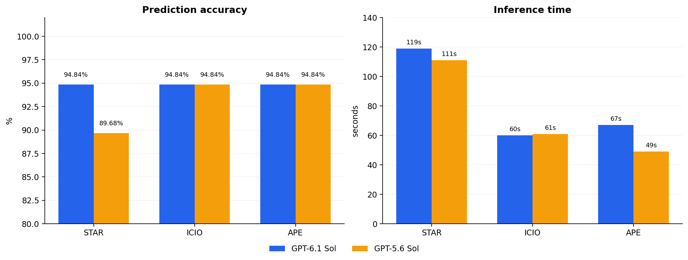

# Task 2 — Restaurant SQL Generation: Prompting Experiment Report

## 1. Objective and setup

The task was to convert **155 natural-language restaurant questions** from `restaurants_dataset.csv` into SQLite `SELECT` queries using the database schema in `restaurants-schema.csv`. Each prediction was required to return the **restaurant house number and restaurant name**, in that order. The outputs were saved as CSV files containing `question,predicted_sql`.

Three prompt structures from Task 1 were compared:

- **STAR:** Situation, Task, Action, Result
- **ICIO:** Instruction, Context, Input, Output
- **APE:** Action, Purpose, Expectation

Each structure was tested with **GPT-6.1 Sol** (default model) and **GPT-5.6 Sol** (older model), giving **six runs**. The accuracy values and inference times below are the recorded experiment results supplied for this report, not a newly rerun database evaluation. The assignment recommends starting a new session for every prompt; whether every recorded run used a fresh session was not independently verified.

## 2. Results

At first all the tests got only **43/155** correctly **(27.74%)**, so I needed to specify in each prompt to return **house number and restaurant name**, after that I got way better results.

| Prompt framework | Model | Correct / total | Accuracy | Inference time | Predictions file |
|---|---|---:|---:|---:|---|
| STAR | GPT-6.1 Sol | 147 / 155 | 94.84% | 1m 59s (119s) | [`restaurants_dataset_predictions_star.csv`](restaurants_dataset_predictions_star.csv) |
| STAR | GPT-5.6 Sol | 139 / 155 | 89.68% | 1m 51s (111s) | [`restaurants_dataset_predictions_star_old_model.csv`](restaurants_dataset_predictions_star_old_model.csv) |
| ICIO | GPT-6.1 Sol | 147 / 155 | 94.84% | 1m 00s (60s) | [`restaurants_dataset_predictions_icio.csv`](restaurants_dataset_predictions_icio.csv) |
| ICIO | GPT-5.6 Sol | 147 / 155 | 94.84% | 1m 01s (61s) | [`restaurants_dataset_predictions_icio_old_model.csv`](restaurants_dataset_predictions_icio_old_model.csv) |
| APE | GPT-6.1 Sol | 147 / 155 | 94.84% | 1m 07s (67s) | [`restaurants_dataset_predictions_ape.csv`](restaurants_dataset_predictions_ape.csv) |
| APE | GPT-5.6 Sol | 147 / 155 | 94.84% | 49s | [`restaurants_dataset_predictions_ape_old_model.csv`](restaurants_dataset_predictions_ape_old_model.csv) |

## 3. Visualization

*Figure 1. Accuracy uses the recorded evaluator scores; inference time is the measured time for each complete run. A higher accuracy is preferable, while a lower inference time is preferable. The accuracy chart begins at 80% to make the difference visible.*

## 4. Analysis and comparison

**Accuracy.** GPT-6.1 Sol achieved **147/155 (94.84%)** for all three frameworks, meaning that changing the prompt format did not affect the reported accuracy for this model. GPT-5.6 Sol also reached **147/155 (94.84%)** with ICIO and APE, but obtained **139/155 (89.68%)** with STAR. The STAR difference was **8 questions**, or approximately **5.16 percentage points**, in favor of GPT-6.1 Sol.

**Inference time.** On GPT-6.1 Sol, ICIO was the fastest (**60 s**), followed by APE (**67 s**) and STAR (**119 s**). On GPT-5.6 Sol, APE was fastest (**49 s**), followed by ICIO (**61 s**) and STAR (**111 s**). STAR was the slowest of the three in both model runs. These six timings are individual observations, so they do not establish statistically reliable speed differences.

**Prediction-file inspection.** All six uploaded CSV files have **155 data rows**, the header `question,predicted_sql`, matching question text and order, and a nonempty, single-line `SELECT` statement in every `predicted_sql` field. This verifies basic structural completeness, **not** that all generated SQL queries have valid semantics or produce the expected database results.

The number of **exactly matching SQL strings** between newer and older model files for the same framework was:

| Framework | Exact SQL string matches (out of 155) |
|---|---:|
| STAR | 0 |
| ICIO | 139 |
| APE | 0 |

Exact textual equality is not the same as query correctness: two queries can differ in capitalization, alias names or formulation and still return equivalent results. Conversely, identical accuracy scores do not prove that the same questions were answered correctly. Per-question ground-truth evaluation would be needed to establish error overlap.

## 5. Conclusion

The experiment found that **all three prompting frameworks performed equally well on GPT-6.1 Sol (94.84%)**. For GPT-5.6 Sol, **ICIO and APE maintained the same 94.84% accuracy**, while STAR fell to **89.68%**. Considering both metrics, **ICIO was the fastest approach at the top recorded accuracy on GPT-6.1 Sol**, whereas **APE was the fastest at the top recorded accuracy on GPT-5.6 Sol**. Overall, changes in prompt framework had little observed impact on accuracy in five of the six runs, but inference times varied substantially.

**Limitations:** There was only one recorded run per framework–model combination, so the measured differences may reflect sampling or runtime variability. The source database and expected results were not provided for independent execution-based validation, so accuracy figures are reported as supplied. Additional independent sessions and analysis of the eight or sixteen unsuccessful questions would provide stronger evidence.

## 6. Deliverables and metadata

The six linked prediction CSV files are included alongside this report. Their filenames identify the prompt and model: unqualified filenames (`_star`, `_icio`, `_ape`) use **GPT-6.1 Sol**, while `_old_model` filenames use **GPT-5.6 Sol**. Each file contains the exact two-column prediction format required by the task. The run-level metadata (prompt, model, accuracy, inference time and filename) is recorded in the results table above and in `experiment_metadata.csv`.
