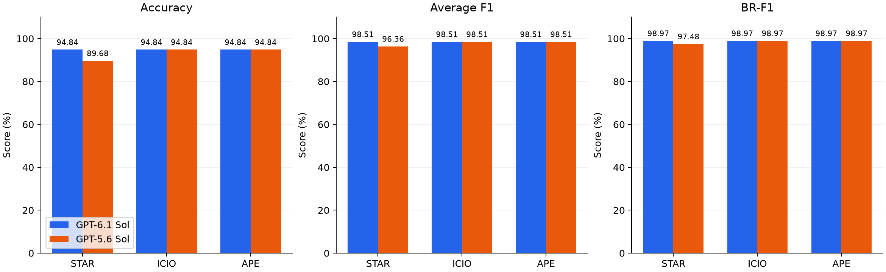
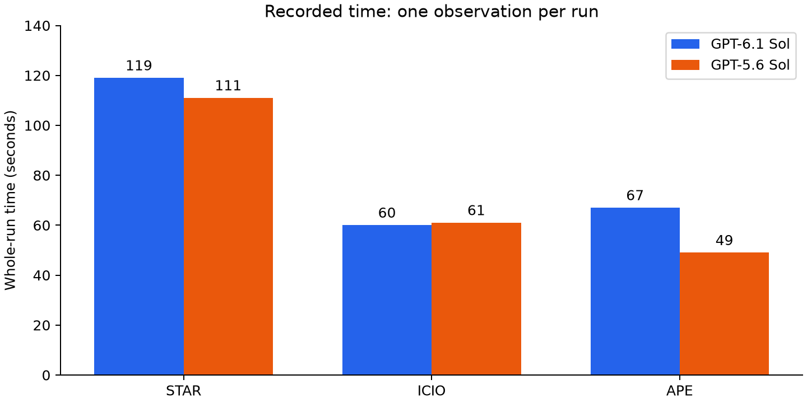
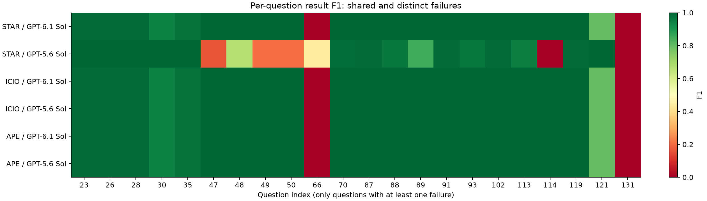

# Task 4: Comparing the prompts

## Setup and metrics

I compared the STAR, ICIO, and APE prompts from [Task_1/output.txt](../Task_1/output.txt) using GPT-6.1 Sol and GPT-5.6 Sol. Each run answered the same 155 restaurant questions by generating SQL. I reused the Task 2 predictions, ran them against the database, and checked all 930 question scores against Task 3.

All six prediction files are now in [Task_2/data](../Task_2/data/). Files named `restaurants_dataset_predictions_{star,icio,ape}.csv` use GPT-6.1; files ending in `_old_model.csv` use GPT-5.6.

- **Accuracy:** how often the returned rows exactly match the expected answer.
- **Average F1:** gives partial credit when some returned rows are correct. Extra or missing rows lower the score.
- **BR-F1:** averages F1 for empty answers and nonempty answers, giving each group half the weight.

## Results

| Prompt | Model | Correct / 155 | Accuracy | Average F1 | BR-F1 | Time (s) |
|---|---|---|---|---|---|---|
| STAR | GPT-6.1 Sol | 147/155 | 94.84% | 98.51% | 98.97% | 119 |
| STAR | GPT-5.6 Sol | 139/155 | 89.68% | 96.36% | 97.48% | 111 |
| ICIO | GPT-6.1 Sol | 147/155 | 94.84% | 98.51% | 98.97% | 60 |
| ICIO | GPT-5.6 Sol | 147/155 | 94.84% | 98.51% | 98.97% | 61 |
| APE | GPT-6.1 Sol | 147/155 | 94.84% | 98.51% | 98.97% | 67 |
| APE | GPT-5.6 Sol | 147/155 | 94.84% | 98.51% | 98.97% | 49 |



Five runs have the same scores on every question. STAR with GPT-5.6 answers eight fewer questions correctly. Compared with the other runs, it loses 5.16 percentage points of accuracy, 2.16 points of average F1, and 1.49 points of BR-F1.

All runs answer the 43 empty-answer questions correctly. The differences come from the 112 questions expecting restaurants. BR-F1 is higher than average F1 because it gives more weight to the perfectly answered empty group. No SQL query fails to execute, so the errors concern what the queries return.



At the highest scores, ICIO is fastest on GPT-6.1 (60 seconds), and APE is fastest on GPT-5.6 (49 seconds). STAR is slowest on both. These are whole-run times from Task 2, including possible agent tool work. With only one measurement per run, the speed differences cannot be tested reliably.

## Statistical significance

Because every run answers the same questions, I compared results question by question. I used the exact McNemar test for accuracy and an exact paired permutation test for F1 and BR-F1. These test whether the observed differences provide evidence against equal performance.

I tested each prompt pair within each model and each model pair within each prompt: nine comparisons across three metrics, or 27 tests. Holm correction accounts for testing several differences. A corrected p-value below 0.05 counts as significant.

The table shows STAR GPT-6.1 minus STAR GPT-5.6. Differences are in percentage points (pp).

| Metric | Difference (pp) | Raw p | Adjusted p |
|---|---|---|---|
| Accuracy | +5.161 | 0.1153 | 1.0000 |
| Average F1 | +2.155 | 0.0694 | 1.0000 |
| BR-F1 | +1.492 | 0.0694 | 1.0000 |

The other nonzero comparisons are STAR versus ICIO or APE on GPT-5.6. They have the same p-values because ICIO and APE have identical scores. Every remaining comparison has zero difference and p = 1. None of the 27 tests found a significant difference after correction. This means there is not enough evidence to claim a reliable difference; it does not prove the prompts are equally good.

Full test results and 95% confidence intervals are in [statistical_comparisons.csv](statistical_comparisons.csv). The intervals use 10,000 paired bootstrap samples with seed 2026. The F1 intervals narrowly exclude zero, but the exact tests do not reach significance. The methods differ; the decision above follows the corrected exact tests.

## Why the results differ



**Prompt:** All three prompts ask for SQLite SELECT queries, the same two output columns, and a CSV that preserves the questions and their order. This shared task may explain the similar scores. STAR explicitly asks the agent to identify joins and filters and verify each query. ICIO gives the most detailed output-format requirements. APE states the action, purpose, and expected file more briefly. These differences could affect how the agent works, but one run per combination cannot show which wording caused an error.

**Model:** STAR GPT-5.6 misses cuisine filters in questions 47-50. For question 47, it returns 11 restaurants instead of the expected one, giving F1 of 16.67%. It also often uses `LOCATION.CITY_NAME` where the newer STAR queries use `RESTAURANT.CITY_NAME`. This changes city and region results. The older STAR run gets six questions right that the newer run misses, but loses fourteen others, leaving eight fewer correct answers overall. ICIO and APE show no score difference between models.

**Coding agent:** The agent reads files, uses the schema, and writes the CSV. Its tool choices, checks, and session history may affect quality and time. There are no action logs to measure these effects separately. Missing filters and different joins are visible in the SQL; their exact cause is uncertain.

**Dataset:** Question 66 asks "What is the lifes greates illusion?" but expects 2,696 restaurant rows. Five runs return nothing; older STAR returns 9,538 rows and gets partial credit. This unusual reference answer should be checked. It was kept unchanged for this comparison.

## Limits and practical choice

There is only one run per prompt and model, and many questions follow similar patterns. These tests describe the saved answers, not variation across repeated generations. More independent runs are needed to judge whether the differences repeat.

Based on the recorded scores and times, ICIO is the best observed choice for GPT-6.1 and APE for GPT-5.6. The timing uncertainty and lack of repeated runs limit this recommendation.

To regenerate the report and graphs from the repository root:

```powershell
python -m pip install -r Week_03_Prompting/Assignments/Task_4/requirements.txt
python Week_03_Prompting/Assignments/Task_4/analyze.py
```

The supporting files are [analysis_summary.csv](analysis_summary.csv), [statistical_comparisons.csv](statistical_comparisons.csv), and [error_details.csv](error_details.csv).
