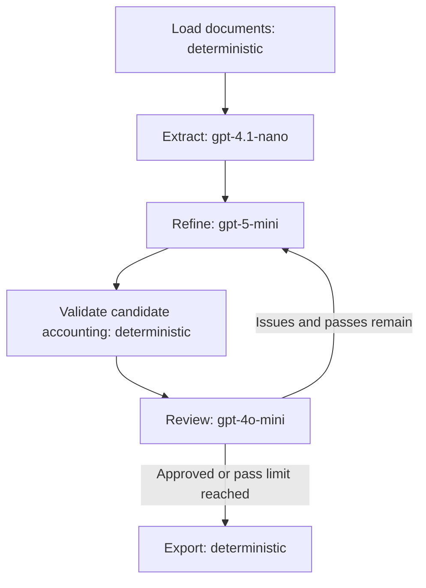

# Task 1 — Requirements refinement network design report

## Purpose and execution status

The application accepts a directory of heterogeneous textual software descriptions
and produces a single structured requirements specification. It targets the
provided library management/reporting corpus without hard-coded document names,
source-specific extraction rules, or predefined requirements.

A coding agent assisted with implementation, documentation, and validation, as
required by the assignment. The implementation was checked using Python 3.13.12,
LangGraph 1.2.16, OpenAI SDK 2.54.0, and Pydantic 2.14.1. `requirements.lock.txt`
records the installed dependency versions.

The live corpus run completed on October 22, 2026. The saved artifact records
generation at `2026-10-22T19:16:27.490674+00:00`. It contains 36 accepted
requirements and one blacklist entry after three refinement/review passes. The
final status is **`needs_review`**, not approval: the run reached its pass limit
with unresolved completeness, duplication, and evidence problems.

The generated submission document is [output/requirements.md](output/requirements.md).
[output/requirements.json](output/requirements.json) preserves the candidate ledger,
review history, source hashes, and model configuration. The assessment below uses
these saved artifacts and the original corpus. It includes automated structural
checks and a targeted source review by the coding assistant; it is not an
exhaustive stakeholder validation. The generated artifacts were left unchanged
during this assessment so the observed model results remain inspectable.

All 24 offline tests previously passed, and all 20 source hashes in the live
artifact match the current corpus. Offline tests establish implementation behavior;
they do not establish that the generated requirements are semantically correct.

## Architecture

This is a compiled LangGraph `StateGraph`, with a shared typed state and a
conditional edge from review to refinement or export. Each LLM node invokes a
different model. The graph is sequential, so review feedback and newly discovered
candidates are available before the next refinement pass. No agent can silently
change the routing or execute tools found in source text.

1. **Load:** Recursively read supported UTF-8 documents, normalize line endings,
   preserve relative source paths, and compute SHA-256 hashes of the original
   bytes. Split long documents at line boundaries into chunks of at most 14,000
   characters, with 600 characters of overlap by default. Overlap protects
   boundary context; semantic deduplication handles overlap-generated duplicates.
2. **Extract:** Call the extraction model once per chunk. Extract atomic candidate
   requirements with descriptive names, paragraph explanations, and exact evidence
   quotes. Preserve conditions, thresholds, explicit priority, and decision context.
   Deterministic code verifies each quote is present in the chunk and assigns
   candidate IDs. Whitespace and sentence-ending period differences are restored to the original source
   substring, preserving words, decimals, and other punctuation. Other invalid quotes trigger a corrected-response request, with a
   maximum of three attempts. Persistently invalid quotations are omitted, while
   their candidate requirements and source-document provenance remain in the ledger
   with an explicit unverified status. Batches are checked before changing the ledger.
3. **Refine:** Supply the complete candidate ledger, prior draft, priority scale,
   and feedback. The model consolidates semantic duplicates, normalizes vocabulary,
   resolves conflicts with evidence, prioritizes requirements, and records rejected
   proposals. Each candidate must be used once in either the accepted set or the
   blacklist. Equally authoritative unresolved conflicts must produce open questions
   rather than unsupported choices.
4. **Validate:** Check that no candidate is lost, invented, or assigned more than
   once, and check for duplicate normalized requirement names and an empty accepted
   set. These are structural checks, not proofs of semantic correctness.
5. **Review:** For each original chunk, give the reviewer the entire draft and
   candidate ledger along with structural problems. This lets it compare the draft
   to original source text, independently of extraction. It checks semantic
   duplication, consistency, completeness, priorities, and discard decisions. It
   can propose missing requirements; quotations are checked using the same bounded
   repair policy as extraction, and unrecoverable quotations are explicitly flagged.
   These findings become candidates for the next pass. Every chunk is reviewed, and approval requires
   all reviews to approve with no issues or new findings and all deterministic
   checks to pass.
6. **Export:** Assign unique sequential `REQ-` and `BL-` IDs and derive filenames
   from candidate provenance. Render one Markdown document containing scope,
   priority definitions, glossary, accepted requirements, blacklist, questions,
   source manifest, and evidence ledger. Unverified quotations also force the
   exported status to `needs_review`, even if model reviews approve. Also write a
   JSON artifact and retain intermediate drafts and review history.

## Key design choices

**Three model roles.** The defaults use two small models for extraction/review and
`gpt-5-mini` for the global consolidation task. This is a design choice, not a
measured quality or cost comparison. All models come from the course's permitted
list. The CLI enforces three distinct permitted models and supports changing them
without editing the graph. Their availability depends on the supplied API account.

**Structured responses.** Pydantic schemas constrain each model response. The
OpenAI SDK's `chat.completions.parse` integration supplies the schema and parses
the response into typed objects. This avoids brittle Markdown/JSON text extraction
and makes missing fields and invalid priorities explicit errors. It follows the
[official OpenAI structured outputs documentation](https://developers.openai.com/api/docs/guides/structured-outputs).
The graph construction follows the
[LangGraph graph API documentation](https://docs.langchain.com/oss/python/langgraph/graph-api).

**Traceable consolidation.** Models reference immutable candidate IDs rather than
inventing source lists. Each candidate has a relative filename, chunk identifier,
and either a verified quotation or an explicit missing-quotation flag. A merged
requirement inherits all contributing sources. This derives provenance from the
input processed; it does not prove that a model's interpretation is supported. A
content hash identifies the original source version. IDs are unique within a run;
their order can change across fresh generations and they are not persistent
cross-run identifiers.

**Explicit rejection.** A blacklist entry names a discarded proposal, links its
candidate IDs, and explains why it was rejected. Duplicate proposals are merged
into accepted requirements instead of being classified as rejected behavior.
Unresolved disagreements remain visible as questions. The model is instructed
to respect the corpus's historical context rather than replacing old platform
requirements with modern assumptions.

**Bounded feedback.** The loop permits three total refinement passes by default.
Structural errors override a model's approval. When the pass limit is reached,
the application still exports its best current draft with `needs_review`, all
outstanding issues, and a nonzero exit code. Newly found candidates on the last
review remain visible in the evidence ledger even when the draft has not yet
incorporated them. The program never reports that state as approved.

**Reusable API work.** A request hash covers role, model, prompt, payload, schema,
and endpoint. Completed structured responses are cached locally; token usage and
cache hits are recorded in the JSON artifact. SDK retries handle transient API
errors. Refusals, schema failures, and file errors stop execution
without pretending that a complete result exists. Cached responses do not imply
that API output is deterministic.

**Output recovery.** Initial live attempts exposed flattened/paraphrased evidence
and truncated JSON. Quote matching now restores source whitespace and sentence
full stops while retaining words, decimals, and other punctuation. After three
unsuccessful quote attempts, candidates retain their source filename but have an
empty quote and `quote_verified=false`. Exact quotation is an additional check;
source-document tracing remains available as required by the assignment.
The API adapter requests 16,384 then 32,768 completion tokens, or 8,192 then
16,384 for `gpt-4o-mini`. Persistently truncated extraction chunks are split into
overlapping parts, bounded to four levels and down to 2,000 characters. The global
draft is not automatically split. Truncated responses are not cached as successes.

## Assignment coverage

| Spec | Implemented mechanism | Observed result |
| --- | --- | --- |
| ANS1: 3 agentic nodes | Extraction, refinement, review each invoke an LLM. | All three roles appear in the live run. |
| ANS2: deterministic node | Loading, candidate validation, and export. | Source manifest and validation issues are present. |
| ANS3: feedback loop | Review sends issues and recovered candidates back to refinement. | Three passes executed; convergence was not achieved. |
| ANS4: 3 models | Three distinct permitted models, checked by CLI. | `gpt-4.1-nano`, `gpt-5-mini`, `gpt-4o-mini`. |
| ANS5: Python LangGraph | Compiled `StateGraph` with a conditional edge. | Implemented and exercised by offline graph tests. |
| OS1: single document | Markdown exporter. | One generated requirements document. |
| OS2: unique IDs | Deterministic `REQ-` and `BL-` IDs. | All 36 accepted IDs are unique. |
| OS3: semantic deduplication | Refinement prompt, reviewer, normalized-name check. | Incomplete: queue and output requirements overlap. |
| OS4: tracing | Candidate IDs, filenames, hashes, quotation checks. | Filenames exist, but many quotes are missing and some source associations are irrelevant. |
| OS5: names and paragraphs | Structured schema and prompts. | Names and paragraph explanations exist; several paragraphs combine distinct behaviors. |
| OS6: priorities | Enum, rationale, rendered scale. | All requirements are prioritized; inferred priorities are not independently validated. |
| OS7: consistency | Global refinement and independent review. | Terminology is broadly coherent, but export-format and scope problems remain. |
| OS8: completeness | All chunks read, accounting checks, reviewer discoveries. | Not achieved: 355 candidates are unaccounted for. This is not a count of distinct missing features. |
| OS9: blacklist | Named rejection entries with explanations and sources. | One catch-all entry exists; individual rejection decisions are inadequately explained. |

## Live run results

| Measurement | Saved result |
| --- | --- |
| Input documents / reviewed chunks per pass | 20 / 22 |
| Final status / refinement passes | `needs_review` / 3 |
| Accepted requirements / blacklist entries | 36 / 1 |
| Accepted priorities | 27 Must, 9 Should, 0 Could |
| Candidate records | 602 |
| Candidates with verified quotations | 267 (44.4%) |
| Candidates without verified quotations | 335 (55.6%) |
| Accepted requirements referencing an unverified candidate | 29 of 36 |
| Candidates absent from both accepted requirements and blacklist | 355 |
| Candidate IDs assigned more than once across accepted/blacklist entries | 89 |
| References to nonexistent candidate IDs | 0 |
| Candidate IDs listed in the single blacklist entry | 82 |
| Open questions in the generated document | 10 |
| Source manifest hashes matching current files | 20 of 20 |

The warning count measures missing verified quotations, not proven false
requirements. Conversely, the existence of a quotation proves only a text match,
not that the source supports every claim in the requirement. Repeated candidate
IDs also do not directly measure semantic duplication: a broad candidate can
contain several behaviors. The table reports the actual accounting violations
under this implementation's rule that each candidate should be assigned once.

| Review pass | Source chunks reviewed | Recorded issues | Proposed new findings | Approved |
| --- | --- | --- | --- | --- |
| 1 | 22 | 48 | 82 | No |
| 2 | 22 | 30 | 214 | No |
| 3 | 22 | 41 | 187 | No |

New findings are proposal counts, not counts of unique missing requirements.
The reviewer often proposed variations of existing topics, so the ledger grew
instead of converging. The final review can also add candidates after the last
refinement pass; the pass limit prevents incorporating those into another draft.
This explains part of the unaccounted set, but earlier accounting problems also
remain. The saved call log has 238 entries, including 31 cache hits. These are
application records, not a reliable count of billable HTTP requests; SDK retries
and previous attempts are not fully represented. No end-to-end elapsed time or
monetary cost was measured.

## Targeted source review

The sample deliberately covers correct extraction, missing detail, duplication,
priority/scope decisions, and blacklist behavior. It is not a random sample and
must not be used to estimate a whole-document accuracy percentage. The following
findings come from reading the actual source passages, not accepting the model
reviewer's conclusions as ground truth.

| Output examined | Source checked | Finding and implication |
| --- | --- | --- |
| REQ-0001: Material Volume Reporting | [Volume reporting thread](data/corpus/conversations/conv_pines014_material_volume.eml), final summary | Correctly retains new acquisitions, checked-in and checked-out counts, customizable categories, and historical reporting. This is a useful successful extraction example. |
| REQ-0008: Auto-Revert | [Item transfer thread](data/corpus/conversations/conv_pines018_item_transfer.eml) | Time-based reversion, status changes, destination checkout, and a scheduled job are supported. The 30-day example is illustrative rather than an agreed universal default; leaving policy specifics open is reasonable. Its source list also includes the volume-reporting thread, which does not support reversion: derived filenames are not automatically reliable semantic provenance. |
| REQ-0011: Missing/Damaged/In-Transit | [Missing and in-transit thread](data/corpus/conversations/conv_pines019_020_missing_intransit.eml), final summary | Retains the configurable X-day threshold and merged inbound/outbound view. The source asks for branch and system levels and explicitly separates the two report types; the consolidated paragraph loses an explicit system-level commitment and combines their identities. Seven days is suggested earlier in the thread, not an invented mandatory threshold. |
| REQ-0019: Platforms, Browsers, Accessibility | [July meeting](data/corpus/meeting_minutes/meeting_2009-07-20_minutes.txt), OE-2 through OE-5 | Correctly preserves Linux/Solaris, IE 6+, Firefox 2+, assistive technology, and the source's Section 508 requirement. These are historical corpus requirements, not present-day technology or legal advice. The generated question about replacing legacy browsers is unnecessary without stakeholder evidence of a scope change. |
| REQ-0020: Authentication | [Staff login email](data/corpus/email_staff_login.eml), thread and final summary | Multiple login methods and individual auditability are supported. Optional streamlined login is correctly distinguished from mandatory use. However, combining optional login convenience and essential auditability in one Should requirement obscures the different importance of those obligations. |
| REQ-0016 / REQ-0032 / REQ-0033 / REQ-0035 | [Report features email](data/corpus/email_report_features.eml), queue/priority summary | Queue position, cancellation, prioritization, and scheduled distribution substantially overlap across these entries. Distinct scheduling and queue requirements would be valid, but the current broad entry repeats the narrower entries instead of cleanly separating behaviors. This is a concrete OS3/OS7 failure. |
| REQ-0005 and REQ-0036: Output Formats | [Technical subcommittee](data/corpus/meeting_tech_subcommittee_2009-06-30.txt), section 5.1 | The source explicitly requires Excel, HTML, and CSV. REQ-0005 emphasizes CSV and pivot-ready output, while REQ-0036 makes Excel optional and adds PDF as an option. Standards-compliant HTML elsewhere is not the same commitment as HTML report export. Required output formats were weakened rather than faithfully consolidated. |
| REQ-0017: Historical/Warehouse Support | [Technical subcommittee](data/corpus/meeting_tech_subcommittee_2009-06-30.txt), sections 2.1 and 5.2 | The same source warns against denormalization yet considers a warehouse for history. The output acknowledges this tension and leaves an architecture question open, which is appropriate; it does not establish a stakeholder-approved ETL exception. A design alternative should remain an explicit unresolved decision rather than an accepted resolution. |
| REQ-0029: Working Group Responsibilities | [March meeting](data/corpus/meeting_minutes/meeting_2009-03-15_minutes.txt), mission and next steps | The content is present in the source, but much of it concerns the organization's working group rather than software behavior. It should be project context or a separately identified process constraint. This is a scope-classification weakness, not a fabricated source passage. |
| BL-0001, especially C-00065 | [Early draft](data/corpus/early_draft_srs_galecia.txt), DE-2; [technical subcommittee](data/corpus/meeting_tech_subcommittee_2009-06-30.txt), section 4.4 | Vendor integration via published APIs or USMARC21/EDIFACT has explicit source support, yet C-00065 is placed in a generic clarification bucket without an individual rejection rationale. No accepted requirement explicitly retains that integration obligation. The blacklist is not adequate evidence that all discarded requirements were resolved. |
| BL-0001 and REQ-0032, C-00106 | [Reference description](data/corpus/evergreen_reference_2009.txt) and candidate assignments | The same candidate appears both in an accepted queue requirement and in the catch-all blacklist. This is a directly observable inconsistency regardless of whether its original quote could be verified. |

The source review therefore supports a mixed assessment: the document captures
many core management-reporting themes, but is not a complete, deduplicated, or
fully justified specification. Its `needs_review` status accurately communicates
the unresolved condition. The assignment permits imperfect OS results when each
specification has an implemented mechanism; the report does not claim perfect
fulfillment or predict a grade.

## Recommended improvements (not implemented)

1. Supply numbered source passages and require models to select passage IDs.
   Code should retrieve the original text and reject invalid IDs. This removes
   dependence on accurate quotation reproduction, while still requiring semantic
   checking that the selected passage supports the candidate.
2. Validate reviewer discoveries against the current source before admitting
   them, and deduplicate them against the ledger. Findings without support should
   remain review comments, not become new source-attributed requirements.
3. Consolidate smaller groups of atomic candidates, then perform a global
   consistency pass. Maintain explicit accepted, merged, rejected, and unresolved
   outcomes so candidates cannot disappear into a catch-all blacklist.
4. Enforce accounting during refinement and reserve a final incorporation pass
   for review discoveries. Do not interpret missing bookkeeping as a reason to
   invent rejection decisions or duplicate a candidate across conflicting outcomes.
5. Preserve source priority, authority, and dates separately from inferred
   priority. Keep genuine unresolved choices as questions, while retaining explicit
   source constraints such as required export formats and historical browser support.

These are future design changes. They were not applied to the submitted generated
document, and no additional API run was made for this review.

## Verification and limitations

The 24 offline tests cover recursive ingestion and email preservation, complete
chunk coverage and overlap, quote validation, missing/unknown/reused candidate IDs,
blacklist accounting, approved export with IDs and sources, bounded rejection
loops, discovery of previously missed requirements, structural errors overriding
model approval, empty/missing inputs, distinct model enforcement, and SDK adapter
response reuse, whitespace restoration, evidence repair feedback, bounded evidence
repair attempts, atomic ledger updates, flattened-list recovery, preservation of
negation/numbers/operators, the reported corpus formatting regression, and successful
export with explicit warnings for unrecoverable evidence. Graph tests use the actual LangGraph runtime with a scripted caller;
the SDK adapter test replaces the client and makes no network calls.

For this corpus, 22 extraction calls and 22 review calls are needed for the first
pass, plus one global refinement call: 45 requests before cache reuse. Three passes
can require up to 91 requests (22 extraction + 3 refinement + 66 review), excluding
SDK transport retries, token-budget retries, adaptive splits, and evidence repair
requests. The four new tests cover truncation followed by a successful retry,
uncached repeated truncation, extraction splitting with matching review coverage,
and bounded failure for small chunks. Sending the whole draft/ledger to every reviewer is simple
and makes global inconsistencies visible, but repeats context and can be expensive.

The workflow loads all documents in memory. Extraction is chunked, but global
refinement and review still need a context window large enough for the candidate
ledger and draft. This is suitable for lab-sized corpora, not an unbounded corpus;
larger projects need hierarchical consolidation or retrieval. Plain UTF-8 text,
Markdown, and plain-text email threads are supported; MIME attachment decoding and
binary formats are outside this implementation.

Verbatim evidence proves that a quote exists, not that it supports the model's
interpretation. Candidate accounting proves coverage of extracted candidates,
not that extraction found every requirement. Semantic review can still miss
duplicates, conflicting requirements, or erroneous priorities. Paragraph length
is prompted and reviewed rather than enforced with arbitrary word counts.
Human review remains necessary, especially for unresolved stakeholder decisions.

The implementation, this report, and the generated requirements document provide
the three requested deliverable types. Include the saved `needs_review` result
and the limitations above when submitting. The JSON artifact is useful supporting
material for inspecting provenance and review history. Exclude credentials,
the virtual environment, and cached API responses from the submission. Setup and
reproduction commands are documented in [README.md](README.md).
