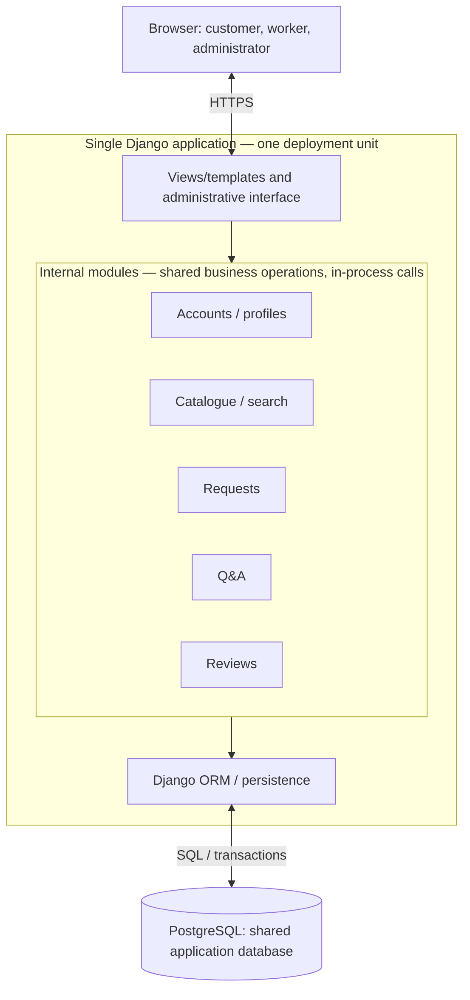

# ADR 001: Layered modular monolith for RentYourExpert

- **Status:** Proposed — architecture and candidate stack await explicit user confirmation.
- **Date:** 2026-10-29
- **Sources:** [Customer description](data/RentYourExpert.txt), [Task 1 discussion](task_1_report.md), [Task 2 assignment](Task_2.md). [Review notes](task_2_report.md) track revisions.

## Context and decision drivers

RentYourExpert connects customers with skilled workers. Its description and 35 user stories require:

- Customer/worker registration, login, profile viewing/editing, customer logout, and administrator login.
- Worker catalogue and profile pages, skill/location search, and worker review display.
- Customer request submission, listing and deletion; addressed workers list requests and accept/reject them.
- Customer questions visible to other customers, answers by the addressed worker, and customer-authored reviews with edit/delete controls.
- Administrator listing, inspection, creation and deletion of customers/workers; viewing all requests and adding/deleting them; review deletion; and deletion of questions together with their answers.

The main drivers are consistent role/ownership authorization, integrity across related data, manageable development and operating effort, clear module boundaries, and growth guided by measurements.

## Proposed decision and reasons

**Recommend one deployable application organized as a layered modular monolith, with PostgreSQL and a candidate Django implementation using server-rendered templates and modest JavaScript.**

The proposal favors this approach because:

- Profiles, requests, reviews, Q&A and administration share closely related data. Local calls and database transactions simplify coordination, including atomic question/answer deletion.
- Shared business operations keep customer, worker and administrator actions consistent.
- Django supplies authentication foundations, ORM, migrations and customizable administration; PostgreSQL supplies relational constraints and transactions.
- One application reduces release and debugging overhead while internal modules support focused testing and later separation.

Separate presentation, application/domain operations, and ORM persistence within the application. Views and administrative actions use shared business operations; writes go through the responsible module. Module boundaries are code boundaries within one process.

## Alternatives considered

The dispositions below express the recommendation, not accepted decisions.

| Approach | Disposition and rationale | Main trade-off |
| --- | --- | --- |
| **Layered modular monolith** — Django/PostgreSQL candidate | Recommended: local transactions and shared rules fit the connected workflows. | Shared deployment/database; boundaries require discipline. |
| **Microservices** — identity/accounts, catalogue, requests and community services with owned data and APIs/events | Set aside initially: independent teams, releases or targeted scaling could justify it, but no such need is established. | Account provisioning/deletion and page aggregation add partial failures, stale data, contracts and operating work. |
| **Managed serverless backend** — React/TypeScript, Supabase Auth/PostgreSQL/data API, database policies/functions and Edge Functions | Credible alternative when managed identity and reduced server administration outweigh policy and provider costs. | Direct data access requires careful row/field permissions and protected transitions; provider coupling, Auth/profile coordination, quotas and costs remain. |

These compare the concrete Task 1 designs. Microservices describe service/data boundaries and serverless describes managed execution; the approaches can coexist.

## Components and communication

The outer box is the application deployment boundary; every internal module is deployed together. Internal arrows represent local calls, not network service APIs. PostgreSQL runs outside this application boundary; the diagram does not select a host or instance count.

| Component | Responsibility |
| --- | --- |
| Browser interface | Customer/worker pages; sends HTTPS requests and displays results, conflicts and errors. |
| Accounts/profiles | Identity, protected roles, sessions, profile information and shared authorization checks. |
| Catalogue/search | Paginated skill/location search and worker pages composed from permitted profile, review and Q&A data. |
| Requests | Customer submission/list/deletion, recipient-worker acceptance/rejection, and administrator request operations. |
| Q&A | Customer questions, addressed-worker answers, and atomic administrator deletion of questions with answers. |
| Reviews | Worker review display, author edit/delete controls, and administrator deletion. |
| Administrative interface | Customized Django admin using shared business operations, including bulk actions. |
| PostgreSQL | Related records, foreign keys, indexes, constraints and transactions. |

**Communication:** browser → HTTPS view → application/domain operation → ORM/PostgreSQL → response. Modules collaborate through in-process calls; the browser has no direct database access. No broker or separate service deployment is proposed initially.

## Consequences and implementation difficulties

**Positive**

- One application/database simplifies development, debugging, releases and transactional workflows.
- Central business operations reduce inconsistent authorization and behavior across interfaces.
- Multiple application instances can support growth; modules provide useful boundaries for tests and potential later extraction.

**Negative and difficult**

- A release or shared database failure can affect all features. Individual modules cannot be independently deployed or scaled as services.
- Preventing arbitrary cross-module writes and scattered rules requires discipline. Later service extraction entails data migration, new contracts and changed transaction boundaries.
- Concurrent request acceptance/deletion and account deletion/request creation need conditional updates, constraints or locks. Lost responses after commit require retry-safe handling, such as operation identifiers with uniqueness checks.
- Framework permissions alone do not enforce ownership or request recipients. Implement server-side checks, protected administrator assignment, safe editable fields, session/CSRF protection and login protection.
- Search/request lists need indexes, pagination and efficient ORM queries. Shared database connections and contention can limit scaling; capacity requires realistic load tests.
- Compatible migrations, upgrades, monitoring, secrets, backups and restoration remain operating responsibilities with managed hosting too. Framework rewrites and data migration become costlier as the system grows.

## Assumptions and unresolved questions

All assumptions here are provisional. The recommendation assumes a browser-oriented product, a small team, ordinary initial traffic, willingness to use Python/Django, and no demonstrated need for independent feature releases. No quantified traffic, latency, uptime, budget, team, integration or deployment constraints were supplied.

Hosting and dependency versions remain undecided; Render with managed PostgreSQL was only a Task 1 example. Payments, checkout, scheduling, private chat and real-time notifications are not established scope; “e-commerce” alone does not define a payment workflow.

Keep the following business questions open until requirements clarification. The user is not the customer and cannot supply missing customer rules.

| Unresolved rule | Architectural significance |
| --- | --- |
| Can one account be both customer and worker? How are administrators provisioned? | Identity/profile relationships and privilege assignment. |
| Request fields, states, acceptance, cancellation, completion and deletion semantics; outcome of concurrent actions | Request model, transitions and history. No pending-only deletion rule is assumed. |
| Review eligibility, association with completed work, and multiplicity | Review relationships and evidence collection; past eligibility cannot reliably be reconstructed later. |
| Account/request deletion, related-content handling and retention | Referential actions and retained history; erased data cannot be restored through a schema migration. |
| Guest access, profile/Q&A/review visibility, Q&A answer multiplicity/editing, and worker verification | Read permissions, exposed fields and moderation behavior. |
| Skill/location matching, “available worker,” and intended project management | Search model and potentially additional workflows. |

Acceptance of the architecture would not settle these rules; clarify them before implementing affected behavior.

## Conditions for revisiting

Revisit when evidence changes the drivers:

- Independent teams/releases, measured uneven workloads or isolation needs justify service boundaries and their coordination costs.
- Managed-platform productivity outweighs policy/provider costs after evaluating actual limits, recovery and project constraints.
- Load tests or production metrics show limits after query/index/capacity improvements; registered-user count alone is insufficient.
- Actual team skills, client needs, integrations, availability/security obligations or clarified business rules invalidate the assumptions or change data ownership.

Record the evidence and consequences in a revision or superseding ADR. Explicit user confirmation is required before changing the status to Accepted.
